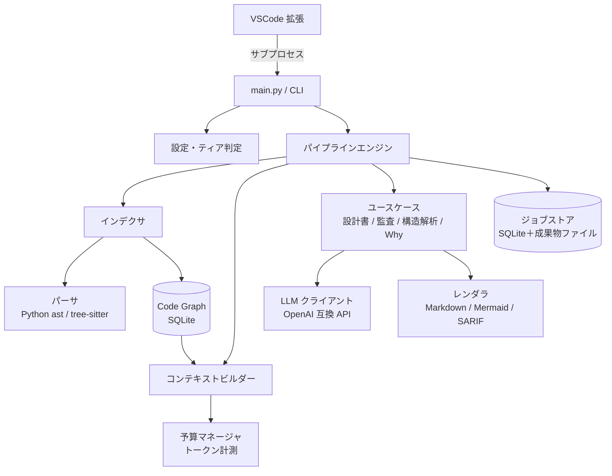
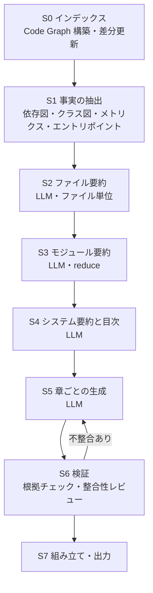

# **詳細設計書：v0.4 大コンテキスト対応と設計書生成の高度化**

- **作成日:** 2026-10-19
- **対象バージョン:** v0.4.0
- **前提資料:** `docs/ideas/20261019-v0.4-review-and-proposal.md`（現状レビューと提案）
- **最優先テーマ:** 設計書生成（ユースケースD）の高度化

---

## **1. 目的と方針**

### 1.1 目的

1. 256K 級のコンテキストを持つローカル LLM で、リポジトリ全体を踏まえた**根拠付きの設計書**を生成できるようにする。
2. 4096 トークン環境の利用者も引き続き使えるようにし、そのうえで大きなコンテキストでは機能を**上乗せ**する。
3. 長時間かかる解析を、途中で止まっても続きから再開できるようにする。

### 1.2 基本方針

| 方針 | 内容 |
|---|---|
| 事実はプログラムで確定 | シンボル・依存関係・呼び出し関係・クラス構造は静的解析で取得し、LLM に推測させない |
| LLM は解釈と文章化 | 責務の説明、設計意図の推定、評価、文章化を担当させる |
| 根拠の明示 | 生成文書の記述には `file:line` の根拠を付け、機械的に存在確認する |
| 階層的な統合 | ファイル → モジュール → システムの順に要約を積み上げる（map-reduce）。小さいコンテキストでも同じ仕組みで動く |
| 段階（ステージ）単位の保存 | 各ステージの成果物を保存し、入力が変わっていないステージは再実行しない |

### 1.3 想定モデル（2026-10-19 時点の調査）

| 項目 | 内容 | 確認状況 |
|---|---|---|
| モデル | Qwen3.8-Flash-Next（Alibaba Qwen Team） | 公式ブログ・公式 GitHub で存在を確認 |
| 規模 | 125B MoE、アクティブ約 6B、別途 N-gram 埋め込み 51B | 公式ブログ・報道で確認 |
| コンテキスト | ネイティブ 262,144 トークン、YaRN で最大 1M | 同上 |
| 推論サーバ | llama.cpp（テキスト・画像）、Ollama にライブラリ登録あり | Unsloth ドキュメント・Ollama ライブラリで確認 |
| 思考モード | ハイブリッド思考（Reasoning Effort 調整） | ユーザー提供情報。API での制御方法は未確認 |

本ツールは特定モデルに依存させない。コンテキスト長・思考モードの制御方法・構造化出力の可否は、**設定値とサーバからの自動取得**で扱う。

---

## **2. 機能ティア（4096 互換と上乗せ）**

### 2.1 ティアの定義

ティアは「1 リクエストで使える入力トークン予算（実効予算）」で決める。モデルの最大コンテキストではなく実効予算を基準にするのは、長い入力ほどプリフィル（入力の読み込み）時間が増え、長文中の情報を見落としやすくなるため。

| ティア | 実効予算の目安 | 想定環境 |
|---|---|---|
| **T1 Compact** | 〜8K（4096 を含む） | 小型 GPU、制限のある社内環境 |
| **T2 Standard** | 8K〜64K | 一般的なローカル環境 |
| **T3 Large** | 64K 以上（256K 級を想定） | Qwen3.8-Flash-Next 等 |

- 実効予算の算出方法は 4.2 節を参照。`LLM_CONTEXT_BUDGET` で上限を指定できる。
- ティアは自動判定し、`AI_AUDIT_TIER` で手動指定もできる。

### 2.2 ティア別の機能（上位ティアは下位の機能をすべて含む）

| 機能 | T1 Compact | T2 Standard | T3 Large |
|---|:---:|:---:|:---:|
| **静的解析（Code Graph）・図の機械生成** | ✅ | ✅ | ✅ |
| **ファイル要約の入力** | スケルトン | 全ソース（入らなければスケルトン） | 全ソース＋関連ファイル |
| **モジュール要約** | 多段 reduce | 1〜2 段 reduce | 1 段（モジュール全体を一括） |
| **章ごとの設計書生成** | 要約のみ参照 | 要約＋関連ソース | 要約＋関連ソースを広く参照 |
| **根拠の存在確認（機械チェック）** | ✅ | ✅ | ✅ |
| **整合性レビュー（LLM による相互チェック）** | ― | ✅ | ✅ |
| **ADR 逆生成（git 履歴を利用）** | ― | ― | ✅ |
| **文脈付き監査**（呼び出し元・先を同梱） | ― | 直接の呼び出し関係のみ | 2 ホップまで |
| **誤検知を落とす検証パス** | ― | ✅ | ✅ |

T1 でも v0.3 より品質が上がる点（静的解析による図、多段 reduce による全体の統合、根拠チェック）を重視する。

---

## **3. 全体アーキテクチャ**



### 3.1 パッケージ構成（v0.4）

```
ai_audit/
  core/
    config.py          設定読み込み（.env）、ティア判定
    llm_client.py      API 呼び出し、構造化出力、思考モード制御、リトライ
    budget.py          実効予算の算出、トークン計測、配分
    server_probe.py    サーバ種別・最大コンテキスト・トークナイザの自動検出
  index/
    scanner.py         ファイル走査、.aiauditignore
    parsers/           python.py / javascript.py / dart.py（共通インターフェース）
    graph.py           Code Graph の構築・差分更新・問い合わせ
  pipeline/
    engine.py          ステージ実行、チェックポイント、再開
    jobstore.py        ジョブ・ステージ・成果物の保存
  context/
    builder.py         予算内でのコンテキスト組み立て
  usecases/
    design_doc/        設計書生成（本書 5 章）
    audit.py           監査（6 章）
    architecture.py    構造解析（7 章）
    why.py             設計思想の抽出・検索
  wears/               プロンプト定義（版数付き）
  render/              markdown.py / mermaid.py / sarif.py
main.py                CLI エントリポイント（唯一のソース）
tests/                 pytest
```

- `vscode-extension/python/` は Git 管理から外し、ビルドスクリプトが `ai_audit/` と `main.py` をコピーする（二重管理の解消）。
- 既存 CLI コマンド名・オプションは維持する。

---

## **4. 共通基盤**

### 4.1 サーバ自動検出（server_probe）

起動時に以下を順に試し、結果を `~/.ai_audit/server_profile.json` にキャッシュする（モデル名変更時に再取得）。

| サーバ | 最大コンテキストの取得 | トークン計測 |
|---|---|---|
| llama.cpp | `GET /props` の `n_ctx` | `POST /tokenize` |
| vLLM | `GET /v1/models` の `max_model_len` | `POST /tokenize` |
| Ollama | `POST /api/show` の `model_info.*.context_length` | なし（推定） |
| その他 | `LLM_CONTEXT_LENGTH`（必須） | なし（推定） |

- 各エンドポイントの仕様は実装時に各公式ドキュメントで再確認する（本書作成時点では未検証）。
- Ollama は実行時のコンテキスト長（`num_ctx`）がモデルの最大値より小さく設定されていることがある。取得値と実行時の値が異なる可能性を警告し、`LLM_CONTEXT_LENGTH` の明示を推奨する。
- 推定時は、API 応答の `usage.prompt_tokens` と推定値の比率を記録して係数を補正する（自己補正）。

### 4.2 予算マネージャ（budget）

```
実効予算（入力＋出力）:
  最大コンテキスト ≤ 16K → 最大コンテキストをそのまま使う（4096 環境向け）
  それ以上             → 最大コンテキスト × 0.5（下限 16K、上限 128K）
  LLM_CONTEXT_BUDGET があればそれを上限とする
入力予算 = 実効予算 − 出力予約 − 安全マージン(5%)   ※システムプロンプトは入力予算に含めて計算
```

- 出力予約の既定値はティアで変える（T1: 1,024 / T2: 4,096 / T3: 8,192）。思考モード有効時は思考トークン分（low 1,024 / medium 4,096 / high 8,192）を加算する。ただし出力予約は実効予算の半分を上限とする。
- トークン数は文字種による推定値に補正係数を掛けて求める。補正係数はサーバの tokenize API と応答の `usage.prompt_tokens` から学習し、`<data_dir>/token_calibration.json` に保存する。
- 入力が予算を超える場合は**黙って切り詰めない**。優先度の低い要素から外し、外した内容は成果物のメタ情報に記録する。

### 4.3 LLM クライアント

| 機能 | 内容 |
|---|---|
| 構造化出力 | `response_format: json_schema` を優先し、非対応なら `json_object`、さらに失敗したら抽出と修復を行い、それでも失敗したら 1 回だけ再生成 |
| 思考モード | `LLM_REASONING`（off / low / medium / high）を設定。サーバ固有パラメータは `LLM_EXTRA_BODY`（JSON）でそのまま渡せるようにし、ハードコードしない。応答の `reasoning_content` や `<think>` ブロックは本文から除去する |
| 並列数 | `LLM_PARALLEL`（既定 1）。llama.cpp の `--parallel` 等に合わせて設定 |
| タイムアウト・リトライ | 接続エラー・5xx のみリトライ（指数バックオフ）。4xx（コンテキスト超過など）はリトライせず、予算を縮小して再試行する |
| 記録 | 呼び出しごとにモデル名・入出力トークン数・所要時間をジョブストアに記録 |

### 4.4 Code Graph（index/graph.py）

SQLite（`<対象>/.ai_audit/graph.db`）に保存する。

- `files` テーブルにファイル単位の解析結果（シンボル・import・呼び出し・スケルトン）を JSON で保存する。
- import と呼び出しの解決は読み込み時にメモリ上で行う（解決規則を変えても再解析が不要）。
- パーサの版数が変わった場合は全ファイルを再解析する。

| 保持する情報 | 内容 |
|---|---|
| ファイル | path（リポジトリ相対）, lang, sha256, loc, モジュール docstring, スケルトン, 解析エラー |
| シンボル | id, kind（class/function/method/interface/type/enum）, qualname, signature, doc, start_line, end_line, parent, bases, calls |
| import | 対象, 名前, 行, 相対 import の深さ |
| 導出情報 | ファイル依存・外部依存・モジュール依存・呼び出し辺（確度付き）・循環・メトリクス・エントリポイント |

- **シンボル ID はリポジトリ相対パス＋修飾名（例: `ai_audit/usecase_d.py::Foo.bar`）**。同名メソッドの衝突（現行の不具合 B1）を解消し、別マシンでも同じ ID になる。
- クラスとメソッドは親子関係で持ち、チャンク化の際に二重に扱わない（不具合 B2 の解消）。
- 呼び出しの解決は名前ベースの近似とし、確度（resolved / ambiguous / unresolved）を持たせる。
- ファイルのハッシュが変わったものだけ再解析する。

### 4.5 ジョブストアと再開（pipeline）

- 1 回のコマンド実行を「ジョブ」、その中の処理単位を「ステップ」とする。
- ステップごとに**入力ハッシュ**（対象ソースのハッシュ、モデル名、プロンプト版数、ティア、設定）を計算し、同じ入力ハッシュの成果物があれば再利用する。
- 成果物は `<対象>/.ai_audit/work/` に JSON / Markdown で保存し、書き込みは一時ファイルからのリネームで行う（途中終了で壊れたファイルを残さない）。
- これにより、
  - 中断後の再実行 → 完了済みステップを飛ばして続きから実行
  - コード変更後の再実行 → 変更ファイルに関係するステップだけ再実行
  - `--force` → すべて再実行
- `ai_audit status` コマンドで、直近ジョブの進捗（完了ステップ数 / 全体、推定残り時間）を表示する。

---

## **5. 設計書生成（ユースケースD v2）**

### 5.1 成果物

出力先の既定は `<対象>/_design/`（`--output-dir` で変更可）。

| ファイル | 内容 | 主な読者 |
|---|---|---|
| `README.md` | 目次、生成条件（モデル・ティア・日時・対象コミット）、カバレッジ | 全員 |
| `overview.md` | 概要設計書（システム概要、機能一覧、ユースケース、構成図、用語集） | 非エンジニア、再実装を依頼する AI |
| `detail.md` | 詳細設計書（全体構造、データフロー、エラーハンドリング方針、横断的関心事） | 保守担当 |
| `modules/<モジュール名>.md` | モジュール別の詳細（責務、主要クラス・関数、依存、図） | 保守担当 |
| `diagrams/*.mmd` | 静的解析から機械生成した Mermaid 図（依存関係、クラス図） | 全員 |
| `adr/*.md` | 設計判断の記録（T3 のみ、git 履歴を利用） | アーキテクト |
| `_meta/coverage.json` | どのファイル・シンボルが文書に反映されたか、外した入力 | ツール・検証 |

- v0.3 の `_design_detail.md` / `_design_overview.md` は `--layout legacy` 指定時のみ出力する（VSCode 拡張は v0.4 で新レイアウトに対応）。

### 5.2 処理ステージ



| ステージ | 処理 | LLM | 再開単位 |
|---|---|:---:|---|
| S0 インデックス | Code Graph を構築（変更ファイルのみ） | ― | ファイル |
| S1 事実の抽出 | モジュール依存図・クラス図の Mermaid 生成、循環依存・fan-in/out の算出、エントリポイント（`main`、CLI 定義、`package.json` の scripts 等）の特定、README・マニフェストの収集 | ― | 一括 |
| S2 ファイル要約 | 1 ファイルずつ要約を JSON で生成（目的、責務、主要シンボル、入出力、副作用、エラー処理、根拠行） | ✅ | ファイル |
| S3 モジュール要約 | ディレクトリ（パッケージ）単位にファイル要約を統合。予算に収まらなければ多段に統合 | ✅ | モジュール |
| S4 システム要約と目次 | 全モジュール要約＋S1 の事実から、システム要約と設計書の目次（章ごとの参照モジュール付き）を生成 | ✅ | 一括 |
| S5 章ごとの生成 | 目次の各章について、システム要約＋関連モジュール要約＋関連ソース（Code Graph から抽出）を予算内で組み立てて生成 | ✅ | 章 |
| S6 検証 | (a) 根拠 `file:line`・シンボル名の存在確認（機械）。(b) T2 以上で章同士・事実との矛盾を LLM がレビュー。不整合のある章のみ S5 を再実行（最大 1 回） | (b) のみ | 章 |
| S7 組み立て | 図・章・目次・カバレッジを結合して出力。T3 では ADR 生成も実行 | ADR のみ | 一括 |

### 5.3 ファイル要約の出力スキーマ（S2）

```json
{
  "path": "ai_audit/usecase_d.py",
  "purpose": "string",
  "responsibilities": ["string"],
  "key_symbols": [{"id": "string", "role": "string", "evidence": "path:start-end"}],
  "inputs_outputs": ["string"],
  "side_effects": ["string"],
  "error_handling": "string",
  "design_intent": "string（推測の場合はそう明記）",
  "confidence": "high | medium | low"
}
```

- `key_symbols[].id` と `evidence` は S6 で Code Graph と突き合わせ、存在しないものは除去して警告する。
- 推測による記述と事実による記述をプロンプトで区別させる（「〜と推測される」と書かせる）。

### 5.4 コンテキスト組み立ての優先順位（S5）

予算に入りきらない場合、下から順に外す。

1. 章の指示と目次（必須）
2. システム要約（必須）
3. 章に関係するモジュール要約
4. S1 で抽出した事実（依存関係・メトリクス）
5. 関係するファイル要約
6. 関係するソースコード（Code Graph で章の対象シンボルから辿ったもの。T1 ではスケルトン）

### 5.5 ADR 逆生成（T3）

- `git log` から、設計に影響しそうなコミット（多数ファイルの変更、依存追加、ディレクトリ構成の変更、メッセージのキーワード）を抽出する。
- コミットメッセージ・差分の要約・該当時点の構造を入力として、「背景・決定・結果・代替案（推測）」の形式で ADR を生成する。
- git 管理外のディレクトリではスキップする。

### 5.6 CLI

```
python main.py generate_design_doc <dir> [--output-dir DIR] [--force]
    [--tier compact|standard|large] [--layout v2|legacy]
    [--only overview|detail|modules|adr] [--lang ja|en]
python main.py status [<dir>]
```

---

## **6. 監査（ユースケースA v2）概要**

設計書生成の後に実装する。ここでは方針のみ定義し、詳細は着手時に追記する。

- 監査単位は Code Graph のシンボル（クラスとメソッドの二重監査をしない）。
- T2 以上では、対象シンボルの呼び出し元・呼び出し先・参照する型のスケルトンを予算内で同梱する。
- ウェアを追加する: パフォーマンス、言語別（JS/TS、Dart）、ファイル横断（アーキテクチャ違反、API 互換性）。
- 出力は JSON Schema で固定し、`line` を必須にする（ファイル内の絶対行番号）。
- T2 以上では検証ウェアで各指摘を再確認し、根拠の弱い指摘を落とす。
- キャッシュキーに「コードのハッシュ＋モデル名＋ウェア版数」を使う（不具合 B7 の解消）。
- 出力形式に SARIF を追加する。

## **7. アーキテクチャ解析（ユースケースC v2）概要**

- 設計書生成の S0〜S3 を共有し、評価ウェアのみ差し替える。
- 循環依存・fan-in/out・不安定度などの数値は機械的に算出し、LLM はその解釈と改善案を担当する。
- バッチごとの結果を並べる現行方式をやめ、モジュール要約を統合した 1 本のレビューにする（不具合 B4 の解消）。

## **8. 設計思想（ユースケースB）の扱い**

- 抽出単位は Code Graph のシンボル（関数・メソッド・クラス）。所属クラスと呼び出し元を文脈として渡す。
- 保存先はプロジェクトごとの SQLite（`<対象>/.ai_audit/why.db`）。v0.3 の ChromaDB 依存は廃止した
  （VSCode 拡張の同梱バイナリだけで設計思想機能が動くようにするため。v0.3 の蓄積データは再抽出が必要）。
- 検索は文字 2-gram の語彙検索を基本とし、`LLM_EMBEDDING_MODEL` が設定されていれば推論サーバの
  `/v1/embeddings` によるベクトル検索と合成する（0.7 × コサイン類似度 ＋ 0.3 × 語彙スコア）。
- VSCode 拡張の CodeLens 用に `<対象>/.ai_audit/why.json`（ファイル → エントリ一覧）を出力する。
- コード・モデル・プロンプト版数が変わらないシンボルは再抽出しない。

---

## **9. 設定項目（.env 追加分）**

| 変数 | 既定値 | 内容 |
|---|---|---|
| `LLM_CONTEXT_LENGTH` | 自動取得 | 最大コンテキスト長（取得できないサーバでは必須） |
| `LLM_CONTEXT_BUDGET` | 自動算出 | 1 リクエストの実効予算 |
| `AI_AUDIT_TIER` | 自動判定 | `compact` / `standard` / `large` |
| `LLM_REASONING` | `off` | 思考モード（`off` / `low` / `medium` / `high`） |
| `LLM_EXTRA_BODY` | なし | リクエストに追加する JSON（サーバ固有パラメータ用） |
| `LLM_PARALLEL` | `1` | 同時リクエスト数 |
| `LLM_EMBEDDING_MODEL` | なし | 埋め込みモデル名（設計思想のベクトル検索用） |
| `LLM_SERVER_TYPE` | `auto` | サーバ種別（auto / llamacpp / vllm / ollama / openai） |
| `LLM_TIMEOUT` | `3600` | 1 リクエストのタイムアウト秒 |

既存の `LLM_API_BASE_URL` / `LLM_API_KEY` / `LLM_MODEL_NAME` / `LLM_MAX_OUTPUT_TOKENS` / `AI_AUDIT_DATA_DIR` はそのまま使う。

---

## **10. 既存不具合の扱い**

`docs/ideas/20261019-v0.4-review-and-proposal.md` の 2.1 節の不具合への対応。

| # | 対応 |
|---|---|
| B1 chunk_id の衝突 | 4.4 のシンボル ID に置き換え |
| B2 二重チャンク化 | 4.4 の親子関係で解消 |
| B3 概要設計書の切り詰め | 5.2 の S4/S5（要約の積み上げ）で解消 |
| B4 統合工程なし | 5.2 の S3/S4、7 章で解消 |
| B5 main.py の二重管理 | 3.1 の単一ソース化 |
| B6 Linux/mac ビルドの依存漏れ | ビルドスクリプトを `requirements.txt` から入れる方式に統一 |
| B7 キャッシュキー | 4.5 の入力ハッシュ、6 章 |
| B8 行番号 | 6 章（`line` 必須） |

## **11. リポジトリ整理**

| 項目 | 対応 |
|---|---|
| `.devcontainer` | Python 3.13＋Node.js の構成に作り直す |
| `CLAUDE.md` | 技術スタックを実態（Python コア＋TypeScript 拡張）に合わせる |
| `docs/ideas/initial-requirements.md` | テンプレート由来の別プロダクト（TaskCLI）の内容のため削除 |
| コミット済み `*.vsix`・`out/` | Git 管理から外す（配布は GitHub Releases） |
| `.steering/` | 作業計画を残すため Git 管理対象にする |

---

## **12. テスト方針**

| 種類 | 内容 |
|---|---|
| 単体テスト | パーサ（シンボル ID・親子関係）、予算計算、JSON 修復、ジョブストアの再開判定 |
| 結合テスト | ダミー LLM サーバ（テスト内で起動し、決まった応答を返す）でパイプライン全体を実行し、成果物の構成・根拠チェック・再開動作を確認 |
| サンプルプロジェクト | `tests/fixtures/` に小さな Python / JS プロジェクトを置き、生成物の構造をスナップショット比較 |
| 実機スモーク | 環境変数 `AI_AUDIT_LIVE_TEST=1` のときだけ、実際の LLM サーバに接続して実行（CI では実行しない） |
| 品質指標 | 根拠の有効率（存在確認に通った割合）、カバレッジ（文書に反映されたモジュールの割合）を `_meta/coverage.json` に出力し、改善の比較に使う |

---

## **13. 実装フェーズ**

作業は main ブランチで直接行い、フェーズ完了時に push する。具体的な手順は `.steering/20261019-v0.4-advanced-analysis/` の手順書で管理する。

| フェーズ | 内容 |
|---|---|
| 1 | リポジトリ整理（11 章）、単一ソース化、テスト基盤 |
| 2 | 共通基盤（サーバ検出・予算・LLM クライアント・Code Graph・ジョブストア） |
| 3 | 設計書生成 v2（S0〜S7、T1/T2） |
| 4 | 設計書生成 v2（T3 機能: 整合性レビューの拡張・ADR） |
| 5 | アーキテクチャ解析 v2 |
| 6 | 監査 v2・設計思想の改善 |
| 7 | VSCode 拡張の追従、README・既存設計書の更新、ビルド |

---

## **参考資料（2026-10-19 確認）**

- Qwen 公式ブログ: https://qwen.ai/blog?id=qwen3.8-flash-next
- Qwen 公式 GitHub: https://github.com/QwenLM/Qwen3.8-Flash-Next
- Alibaba Cloud Community: https://www.alibabacloud.com/blog/qwen3-8-flash-next-a-new-architecture-towardsultimate-cost-efficiency_603501
- Unsloth（ローカル実行）: https://unsloth.ai/docs/models/qwen3.8-next
- Ollama ライブラリ: https://ollama.com/library/qwen3.8-flash-next
