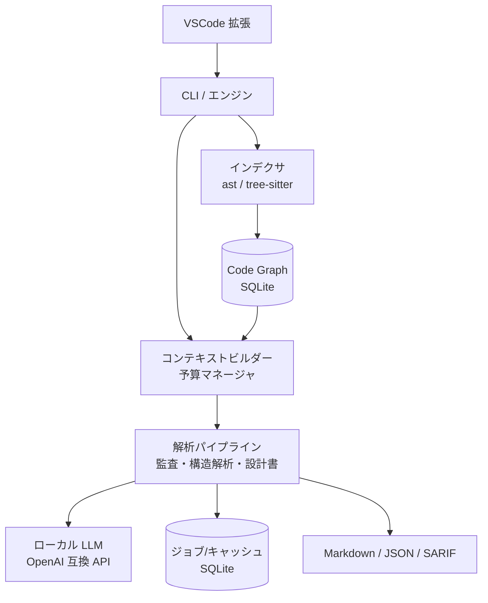

# ai_audit v0.4 見直し提案（現状レビューと改善方針）

- 作成日: 2026-10-19
- 位置づけ: `docs/ideas/` の壁打ち資料（正式な設計書ではない）。承認後に正式な設計書・手順書へ展開する。
- 対象コミット: `7d16e4c`（2026-02-23 時点の main）

---

## 1. 前提の変化

| 項目 | v0.3.x 設計時（2026-02） | 現在（2026-10） |
|---|---|---|
| 想定モデル | GPT-oss-120b / 入力 4096 トークン | 256K コンテキストのローカル LLM（例: Qwen3-Coder-Next） |
| 基本戦略 | 全体把握を放棄し、関数単位に細切れにして多重推論 | リポジトリの大部分〜全体を一度に渡せる |
| ボトルネック | コンテキスト長 | 推論速度（プリフィル時間）、長文中の注意力低下、ハルシネーション |

補足（2026-10-19 時点の調査）:
- Qwen3-Coder-Next は 2026-02 公開、80B MoE（アクティブ約 3B）、ネイティブ 262,144 トークン。根拠は Qwen 公式 Hugging Face ページ（https://huggingface.co/Qwen/Qwen3-Coder-Next-GGUF）。
- ユーザーが挙げた「qwen3.8 flush next」はモデル名を特定できていない（要確認）。設計は特定モデルに依存させず、**コンテキスト長などを設定値・自動取得値として扱う**方針にする。

`docs/5. 大コンテキスト時代を見据えたロードマップ.md` で予見していた「スマート・コンテキスト構築」「グローバル影響解析」「ADR 逆生成」を、クラウドではなくローカル LLM で実現する段階に来ている、という整理になる。

---

## 2. 現状コードのレビュー結果

### 2.1 不具合・品質リスク（確認済み）

| # | 内容 | 該当箇所 | 影響 |
|---|---|---|---|
| B1 | **chunk_id が `絶対パス:名前` のため衝突する**。別クラスの同名メソッド（`__init__` 等）が同じ ID になる | `ast_parser.py` `_parse_chunks_python` | キャッシュが毎回不一致になる／監査結果・Why が上書きされる |
| B2 | `ast.walk` でクラスとその中のメソッドを両方チャンク化している | 同上 | 同じコードを二重に監査する（推論コスト増、指摘の重複） |
| B3 | **概要設計書の入力が詳細設計書の先頭 2000 文字だけ**（`truncate_to_limit`） | `usecase_d.py` `_generate_overview` | 大きなプロジェクトでは概要設計書が一部しか反映されない |
| B4 | ユースケース C/D はバッチごとに独立して推論し、**統合（reduce）工程がない** | `usecase_c.py` / `usecase_d.py` | 全体を通した評価・設計書にならない。バッチ見出しのファイル範囲も概算で、実際と一致しないことがある |
| B5 | ルートの `main.py` が古い（`generate_design_doc`・`list_why`・`extract_why --force` がない）。`ai_audit/` パッケージは拡張側と同一内容の**二重管理** | `main.py` / `vscode-extension/python/` | README の CLI 手順がルートでは動かない |
| B6 | Linux/mac のビルドスクリプトで tree-sitter・chromadb をインストールしていない（Windows 版はインストールしている） | `build_linux.sh` / `build_mac.sh` | おそらく Linux/mac 版バイナリでは JS/TS/Dart が黙って 0 件になる（動作未検証） |
| B7 | 監査キャッシュのキーがコードのハッシュのみで、モデル名・プロンプト版数を含まない | `cache_manager.py` | モデルを変えても再監査されない |
| B8 | `line_number_offset` が常に `null` 指定で、指摘の行位置が関数の先頭にしか付かない | `wear_manager.py` | エディタ上の波線が実際の問題行とずれる |

### 2.2 設計上の制約（4096 トークン前提が残っている箇所）

- `DEFAULT_CHAR_LIMIT = 2000` 文字がハードコードされ、全ユースケースで黙って切り詰めている。
- トークン数は文字数からの推定で、実際のトークナイザを使っていない。
- 監査は 1 チャンク単独で、呼び出し元・呼び出し先・型定義を見ないため、文脈が必要な指摘（認可漏れ、データフロー由来の脆弱性など）ができない。
- ウェアは security / readability の 2 種のみ。設計書 1 章にある「パフォーマンス」ウェアは未実装。JS/TS/Dart も Python 向けウェアを流用している。
- 依存関係・クラス図を LLM に推測させており、静的解析で確定できる事実まで LLM 任せになっている（ハルシネーションの温床）。
- ChromaDB は埋め込みモデルを指定していないため、おそらく既定の英語向けモデル（all-MiniLM-L6-v2）が使われ、日本語の Why 検索精度が低い可能性がある（未検証）。

### 2.3 リポジトリ管理面

- `.steering/*` が `.gitignore` 対象のため、作業計画がリモートに残らない（**中断・再開の仕組みとして使えない**）。
- テストが 1 本もない。
- `.devcontainer` が別プロジェクト（`claude-code-book-chapter8`）のもので Python がない。`CLAUDE.md` の技術スタックも Node.js/TS のみで、実態（Python コア + TS 拡張）と合っていない。
- `docs/ideas/initial-requirements.md` はテンプレート由来の別プロダクト（TaskCLI）の内容。
- `*.vsix` は ignore 対象だが、`ai-audit-win-0.3.1.vsix`（13MB）と `out/extension.js` がコミット済み。

---

## 3. 改善提案

### 3.1 基本方針

**「細切れ × 多重推論」から「静的解析で事実を確定 → 必要な文脈を組み立てて LLM に渡す → 階層的に統合する」へ転換する。**

- 事実（シンボル、依存関係、呼び出し関係、メトリクス）はプログラムで確定させる。
- LLM には解釈・評価・文章化を担当させ、出力には根拠（`file:line`）を必須にする。
- 4096 トークン環境でも動くよう、コンテキスト予算を設定値にして**小コンテキストモード**を残す（後方互換）。

### 3.2 提案一覧（優先度順）

| ID | 提案 | 内容 | 優先度 |
|---|---|---|---|
| P0 | 土台整備 | 二重管理の解消（単一ソース化、拡張側はビルド時にコピー）、B1〜B8 の修正、pytest＋モック LLM によるテスト基盤 | 必須 |
| P1 | コンテキスト予算マネージャ | コンテキスト長を設定値＋サーバから自動取得（Ollama `/api/show`、llama.cpp `/props` 等）。実トークナイザ（llama.cpp `/tokenize` 等）があれば使い、なければ推定値にフォールバック。入力・出力・安全マージンの配分を一元管理 | 必須 |
| P2 | コード知識ベース（Code Graph） | tree-sitter/ast でシンボル・import・呼び出し・継承を抽出し SQLite に保存。ファイルハッシュによる差分更新。以降のすべての機能の土台 | 必須 |
| P3 | 文脈付き監査 | 対象関数＋呼び出し元/先・関連型のスケルトンを予算内で同梱して監査。ウェア追加（パフォーマンス、言語別、ファイル横断のアーキテクチャ違反・API 互換性）。JSON Schema による構造化出力、行番号の必須化、**検証パス**（別ウェアで誤検知を落とす）。SARIF 出力 | 高 |
| P4 | 階層的アーキテクチャ解析 | 依存グラフから循環・fan-in/out・不安定度などを機械的に算出 → ファイル要約 → モジュール要約 → システム全体評価の map-reduce。小〜中規模なら全ソースを一括投入 | 高 |
| P5 | 設計書生成の高度化 | 構成案（目次）を先に生成 → 章ごとに生成 → 整合性チェック。Mermaid 図は Code Graph から機械生成（LLM に推測させない）。各記述に根拠リンク。git 履歴からの ADR 逆生成。章単位のチェックポイントで中断再開 | 高 |
| P6 | ジョブエンジン | 長時間処理（大規模リポジトリの解析）をジョブとして SQLite に記録し、ステップ単位で再開可能にする | 中 |
| P7 | Why 検索の改善 | 埋め込みをローカル LLM サーバの `/v1/embeddings`（多言語モデル）に変更。Code Graph と組み合わせたハイブリッド検索 | 中 |
| P8 | VSCode 拡張追従 | 新コマンド・進捗表示・SARIF/問題パネル連携 | 中 |

### 3.3 想定アーキテクチャ（概略）

---

## 4. 作業の進め方（中断・再開の工夫）

### 4.1 ドキュメント構成案

| 種類 | 置き場所 | 内容 |
|---|---|---|
| 設計書（永続） | `docs/6. 詳細設計書_v0.4_大コンテキスト対応.md`（仮） | 3 章の提案を正式な設計に落としたもの |
| 手順書（作業単位） | `.steering/20261019-v0.4-advanced-analysis/` | `requirements.md` / `design.md` / `tasklist.md` |
| 再開用メモ | 同ディレクトリの `HANDOFF.md` | 「現在地」「次にやること」「未解決事項」「直近の判断とその理由」を 1 画面に収める |

### 4.2 再開可能にするルール

1. タスクは **1 タスク＝1 コミットで完結する粒度**にし、ID（例: `T2-03`）を振る。
2. コミットメッセージに タスク ID を入れる。`git log` だけで進捗を追える状態にする。
3. タスク完了ごとに `tasklist.md` のチェックと `HANDOFF.md` の「現在地」を更新し、同じコミットに含める。
4. 作業途中で止まる場合は WIP コミットを作らず、`HANDOFF.md` に途中状態を書いてからコミットする。
5. 各フェーズ完了時にテストを通したうえで main へ push する。
6. 再開時の手順は「`HANDOFF.md` を読む → `tasklist.md` の最初の未完了タスクから再開」に固定する。

※ `.steering/` は現在 Git 管理外のため、今回の作業ディレクトリだけ追跡対象にする `.gitignore` 変更が必要（要承認）。

### 4.3 フェーズ案

| フェーズ | 内容 | main へ push するタイミング |
|---|---|---|
| Phase 0 | 本提案の承認、設計書・手順書の作成 | 各ドキュメント承認後 |
| Phase 1 | P0 土台整備（単一ソース化・バグ修正・テスト基盤） | フェーズ完了時 |
| Phase 2 | P1 予算マネージャ＋ P2 Code Graph | 同上 |
| Phase 3 | P3 文脈付き監査 | 同上 |
| Phase 4 | P4 アーキテクチャ解析＋ P5 設計書生成 | 同上 |
| Phase 5 | P6〜P8、ドキュメント・README 更新、VSIX ビルド | 同上 |

---

## 5. 確認したい事項

1. 使用予定のモデル名と推論サーバ（Ollama / llama.cpp / LM Studio / vLLM のどれか）。コンテキスト長の自動取得・トークナイザの実装方針が変わる。
2. 4096 トークン環境（小コンテキストモード）の互換性を維持するか。
3. 優先したい機能（監査／アーキテクチャ解析／設計書生成）。
4. ブランチ運用: 指定の作業ブランチ `claude/project-review-advanced-analysis-cbfoor` で作業し、区切りで main に fast-forward で反映する運用でよいか。
5. `.steering/` を一部 Git 管理対象にしてよいか。
6. 2.3 の整理（devcontainer・CLAUDE.md・テンプレート残骸・コミット済み VSIX）を今回の範囲に含めるか。

---

## 6. 決定事項（2026-10-19 ユーザー回答）

1. 想定モデルは Qwen3.8-Flash-Next（262K ネイティブ、YaRN で 1M）。公式ブログ・公式 GitHub で存在を確認。
2. 4096 互換は維持する。4096 向けを基本とし、大きいコンテキスト向けに機能を上乗せする構成にする（設計書 2 章のティア）。
3. 最優先は設計書生成。
4. 作業は main ブランチで直接行う。
5. `.steering/` の Git 管理範囲は実装側で判断する（作業計画を残すため管理対象にする）。
6. リポジトリ整理（2.3 節）は今回の範囲に含める。

正式な設計は `docs/6. 詳細設計書_v0.4_大コンテキスト対応.md` を参照。
